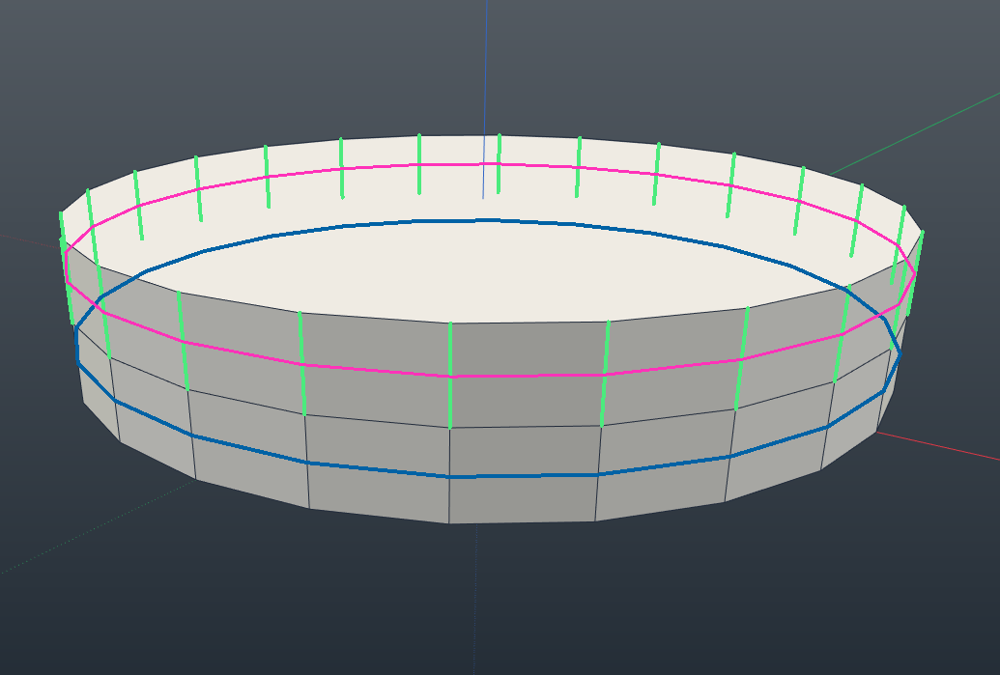

# Loop Cut para IngeTrazo

Extensión independiente para crear cortes y seleccionar loops de aristas en mallas cerradas. Archivo instalable: [loop_cut.py](loop_cut.py).

Versión preparada: v1.1.0 · Licencia: MIT · Autor: Daniel Wagner
[English](README.en.md) · [Português](README.pt-BR.md)

## Novedades de v1.1.0

- Una pared lateral cilíndrica detecta automáticamente su banda cerrada de cuadriláteros.
- Alt+clic selecciona el **bucle de aristas (Edge Loop)** en verde.
- Shift+clic directamente sobre una arista selecciona y añade el **anillo de aristas (Edge Ring)** en azul oscuro.
- El clic normal conserva el corte rosa y el deshacer en un solo paso.

## Demostración

Rosa = **Corte en loop (Loop Cut)**; verde = **bucle de aristas (Edge Loop)**; azul oscuro = **anillo de aristas (Edge Ring)**.

## Instalación

1. Descarga [loop_cut.py](loop_cut.py).
2. En IngeTrazo abre **Extensiones → Abrir carpeta de complementos**. En Windows suele ser %APPDATA%\IngeTrazo\plugins\.
3. Copia el archivo a esa carpeta; para actualizar, sustituye el `loop_cut.py` anterior y reinicia IngeTrazo.

La herramienta aparece en **Extensiones** y añade la barra **LoopTools**.

## Uso

1. Activa **Corte em loop** desde el menú o la barra.
2. Sitúa el cursor sobre una arista o una cara lateral cuadrilateral.

   - Sin modificador: la línea rosa muestra el corte previsto.
   - Con **Alt**: la previsualización verde muestra el **bucle de aristas (Edge Loop)**.
   - Con **Shift** directamente sobre una arista existente: la previsualización azul oscuro muestra el **anillo de aristas (Edge Ring)**.

3. Haz clic según la acción deseada.

   - **Clic:** crea el corte.
   - **Alt+clic:** selecciona el Edge Loop verde.
   - **Shift+clic:** añade el Edge Ring azul oscuro a la selección.

**Ctrl+Z** deshace el corte. Las selecciones no cambian la geometría.

## Cómo funciona

Para el corte y el Edge Loop verde, la extensión recorre aristas opuestas de una banda cerrada de cuadriláteros. En la pared de un cilindro compara las cuatro aristas de la cara y usa la banda cerrada válida más larga; no hace falta acertar una arista vertical fina.

El anillo azul oscuro usa otra lógica: sigue aristas existentes, conectadas extremo con extremo y coplanares, hasta cerrar un ciclo. Puede seleccionar una fila horizontal creada por cortes anteriores.

Si no existe una banda de cuadriláteros válida, el clic normal conserva el corte por sección plana en piezas compatibles con triángulos o polígonos de más lados. Los recorridos abiertos, con agujeros, ramificados o ambiguos se rechazan antes de modificar la malla.

## Alcance y límites

- Trabaja sobre la malla activa y admite las API de plugins 1 y 2.
- Los cortes se sitúan en el punto medio; no incluyen deslizamiento ni posición numérica.
- La selección azul requiere una arista existente y un ciclo cerrado; no convierte curvas abiertas en loops.
- La API de IngeTrazo puede cambiar durante la serie 0.x.

## Licencia

MIT. Consulta [LICENSE](LICENSE).
