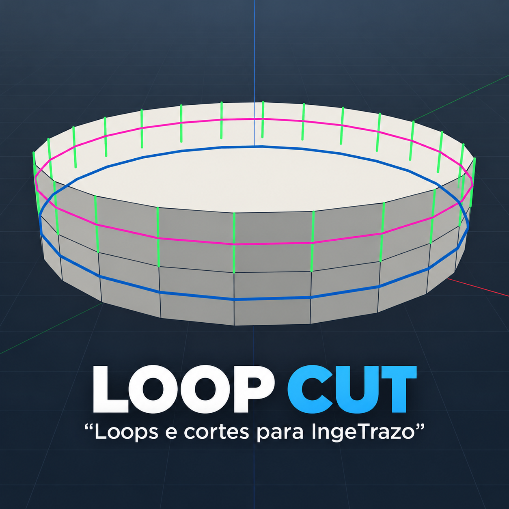

# Loop Cut para IngeTrazo

Extensão independente para criar cortes e selecionar loops de arestas em malhas fechadas. Instale [loop_cut.py](loop_cut.py).

Versão preparada: v1.1.0 · Licença: MIT · Autor: Daniel Wagner
[Español](README.md) · [English](README.en.md)

## Novidades da v1.1.0

- Ao apontar para a parede lateral de um cilindro, a extensão identifica automaticamente a faixa fechada de quadriláteros e mostra o corte transversal.
- **Alt+clique** seleciona o **Loop de Arestas (Edge Loop)** em verde.
- **Shift+clique** diretamente numa aresta seleciona o **Anel de Arestas (Edge Ring)** em azul-escuro e o adiciona à seleção.
- O clique normal mantém o corte rosa e o desfazer em uma única etapa.

## Demonstração

Rosa = **Corte em Loop (Loop Cut)**; verde = **Loop de Arestas (Edge Loop)**; azul-escuro = **Anel de Arestas (Edge Ring)**.

## Instalação

1. Baixe [loop_cut.py](loop_cut.py).
2. No IngeTrazo, abra **Extensões → Abrir pasta de complementos**. No Windows, normalmente é %APPDATA%\IngeTrazo\plugins\.
3. Copie o arquivo para essa pasta — para atualizar, substitua o `loop_cut.py` anterior — e reinicie o IngeTrazo.

## Uso

1. Ative **Corte em loop** pelo menu ou pela barra LoopTools.
2. Passe o cursor sobre uma aresta ou sobre uma face lateral quadrilateral.

   - Sem modificador: prévia rosa do corte.
   - Com **Alt**: prévia verde do Loop de Arestas (Edge Loop).
   - Com **Shift**, diretamente sobre uma aresta existente: prévia azul-escuro do Anel de Arestas (Edge Ring).

3. Clique:

   - **Clique:** cria o corte.
   - **Alt+clique:** seleciona o Edge Loop verde.
   - **Shift+clique:** adiciona o Edge Ring azul-escuro à seleção.

**Ctrl+Z** desfaz o corte. As seleções não alteram a geometria.

## Funcionamento e limites

Para o corte e o Edge Loop verde, o Loop Cut percorre arestas opostas de uma faixa fechada de quadriláteros. Na parede de um cilindro, ele avalia as quatro arestas da face e usa a faixa fechada válida mais longa; não é preciso acertar uma aresta vertical fina.

O anel azul-escuro usa outra busca: segue arestas existentes, coplanares e conectadas ponta a ponta até fechar um ciclo. Ele exige uma aresta real e um ciclo fechado; não converte uma curva aberta em loop.

Em geometria compatível com faces mistas, o corte normal mantém a alternativa de seção plana. Caminhos abertos, com furos, ramificados ou ambíguos são recusados antes de alterar a malha. A extensão suporta APIs de plugin 1 e 2; a API 0.x do IngeTrazo pode mudar.

## Licença

MIT. Consulte [LICENSE](LICENSE).
